Hi, I'm Alessio, a PhD student at the [Music Technology Group](https://www.upf.edu/web/mtg) of Universitat Pompeu Fabra in Barcelona, where I work on music and audio representation learning.

Before that I was an Applied Scientist at Amazon, taking speech generation models for Alexa and beyond from research to production, with a keen interest in multilingual and multimodal systems.

[Website](https://alessiofalai.it) · [Publications](https://alessiofalai.it/academia/) · [Google Scholar](https://scholar.google.com/citations?user=vO0z7VIAAAAJ) · [LinkedIn](https://www.linkedin.com/in/alessio-falai) · [CV](https://github.com/Wadaboa/cv-resume/raw/master/cv.pdf) · [Email](mailto:falai.alessio@gmail.com)
